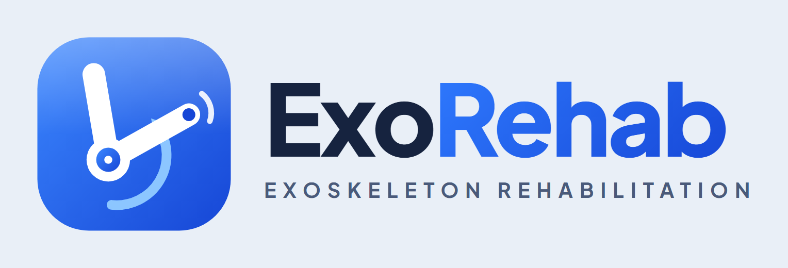
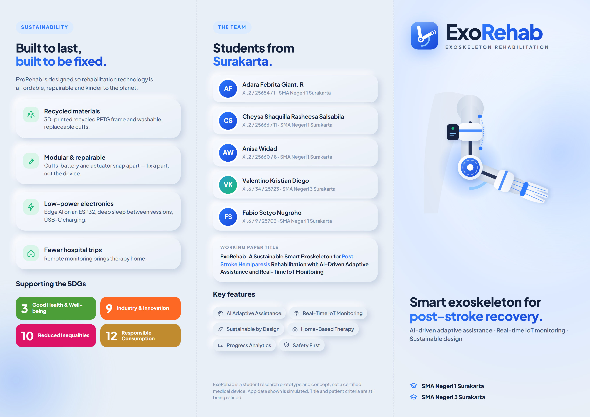
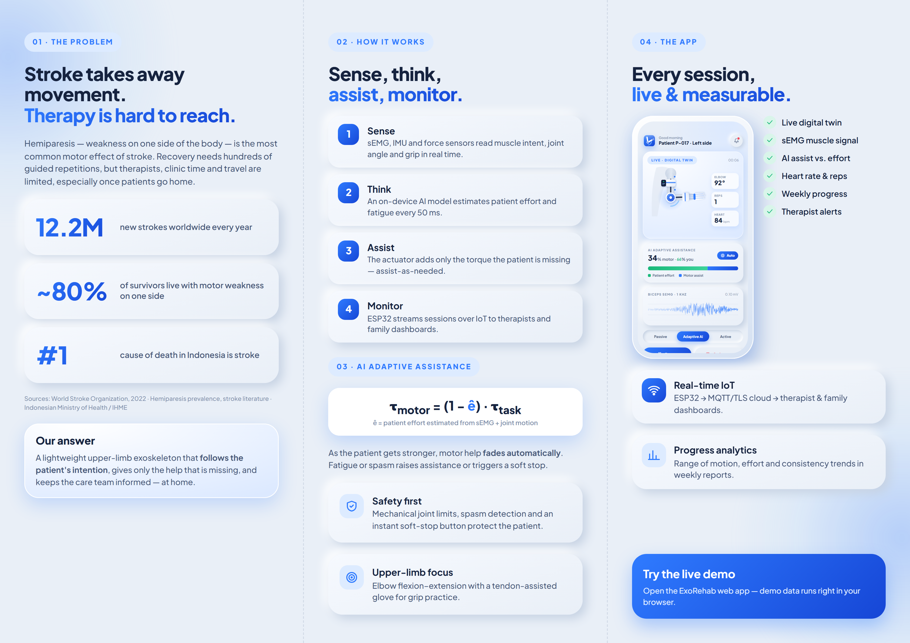

# ExoRehab — Exoskeleton Rehabilitation

**Live demo:** [exorehab.web.app](https://exorehab.web.app) · [Web app](https://exorehab.web.app/app) · [Device simulator](https://exorehab.web.app/simulator) · [Showreel](output/ExoRehab_Showreel_1080p.mp4)

<p align="center"></p>

<p align="center">
  
  
</p>

Brand, web app, landing page, A0 poster, trifold brochure and showreel for the student research project
**"ExoRehab: A Sustainable Smart Exoskeleton for Post-Stroke Hemiparesis Rehabilitation with AI-Driven Adaptive Assistance and Real-Time IoT Monitoring"**.

Team: Adara Febrita Giant. R, Cheysa Shaquilla Rasheesa Salsabila, Anisa Widad, Fabio Setyo Nugroho (SMA Negeri 1 Surakarta) and Valentino Kristian Diego (SMA Negeri 3 Surakarta).

## Final files (`output/`)
| File | What |
|---|---|
| `ExoRehab_Poster_A0.pdf` / `.png` | A0 poster (841 × 1189 mm, vector PDF) |
| `ExoRehab_Brochure_Trifold_A4.pdf` | Trifold, A4 landscape, page 1 = outside, page 2 = inside |
| `ExoRehab_Brochure_outside.png` / `_inside.png` | Brochure previews (3× resolution) |
| `ExoRehab_Showreel_1080p.mp4` | 63 s showreel, 1920×1080, 30 fps, with royalty-free synth music |
| `logo/` | Logo mark (SVG + 1024 px PNG), horizontal lockup, white lockup, stacked |

Files starting with `_` are temporary previews and can be deleted.

## Web (`web/`)
- `index.html`: landing page (problem, how it works, features, architecture, sustainability, app preview, showreel, team).
- `app.html`: mobile web app (Home, Session with live digital twin + sEMG + AI assist, Progress, IoT Monitor, Device), running in **demo mode** with simulated data. It is installable as a PWA (`manifest.json`, `sw.js`).
- To run: open `web/index.html` directly, or serve the folder (`python -m http.server` inside `web/`) and deploy it to any static host (Firebase Hosting, Netlify, GitHub Pages).

## Live site & Firebase
- **https://exorehab.web.app**: landing page · `/app`: web app · `/simulator`: virtual device.
- Realtime Database `exorehab-default-rtdb`, one node per device (`?device=exo-02` selects another device; IDs must match `exo-NN`):
  - `devices/{id}/live`: latest packet from the ESP32 or the simulator (10 Hz): `angle, assist, effort, hr, reps, battery, t, ts, mode, source, emg[]`
  - `devices/{id}/config`: settings from the app (`mode`, `maxFlexion`, `aiAdaptive`, `spasmStop`, `shareTherapist`)
  - `devices/{id}/sessions`: append-only session summaries
- The app shows **live** data while packets arrive (within the last 4 s) and falls back to the demo simulation otherwise. Opened as a local `file://`, it always runs in demo mode.
- Rules (`database.rules.json`) allow writes without login, but only to `devices/exo-NN` and only with validated fields. Everything else is denied. Before using real patient data, add Firebase Auth and tighten the rules.
- ESP32 starter firmware: `firmware/exorehab_esp32/exorehab_esp32.ino`. It sends the same packet format as the simulator.
- Deploy: `firebase deploy --only hosting,database --project exorehab`. Bump `VERSION` in `web/sw.js` when you change cached files.

## Change the title, names or copy
Everything shared lives in **`web/shared/content.js`**. Changing `condition`, for example `"Partial Stroke/Hemiparesis"`, updates the landing page, poster, brochure and showreel.
Colours and fonts live in `web/shared/tokens.css`. The exoskeleton illustration is parametric, in `web/js/exoarm.js`.

## Rebuild
```bash
python tools/export_brand.py           # logo PNGs
python tools/export_print.py           # poster + brochure PDF/PNG
python video/build_showreel.py         # showreel (~6–8 min); --preview 3,15,30 for still frames
```
Requirements: Python with `playwright`, `numpy`, `Pillow`, plus FFmpeg.

## Assumptions / still to confirm
- **Title:** uses "Post-Stroke Hemiparesis" (the standard medical term) instead of "Ischemic Stroke"; it can be changed with one line in `content.js`.
- **Device scope:** the visuals show an **upper-limb (elbow + hand) exoskeleton** with sEMG, IMU, ESP32-S3 and an elbow actuator. Adjust if the team picks a different limb or other hardware.
- **App data is simulated** (patient "P-017", reps, ROM, charts). Replace it with real prototype data once testing starts.
- **Statistics** are rounded public figures: 12.2M strokes/year (World Stroke Organization, 2022); ~80% of survivors with one-sided motor weakness (commonly cited hemiparesis prevalence); stroke as the leading cause of death in Indonesia (Ministry of Health / IHME). Verify them and cite the exact sources in the paper.
- **Team detail strings** (class / number / ID) are shown exactly as provided.
- The poster/brochure state that ExoRehab is a research prototype, not a certified medical device.
